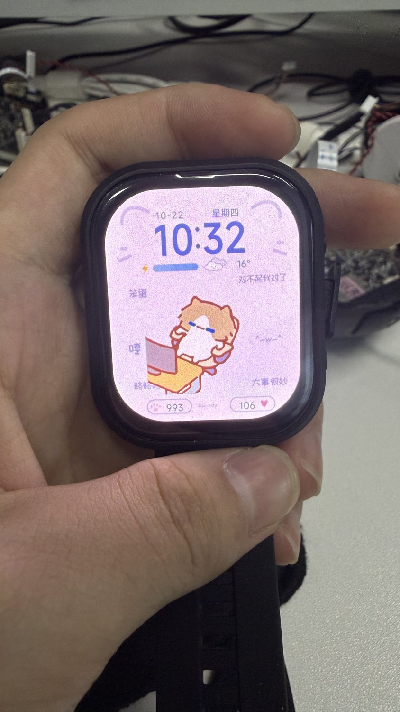
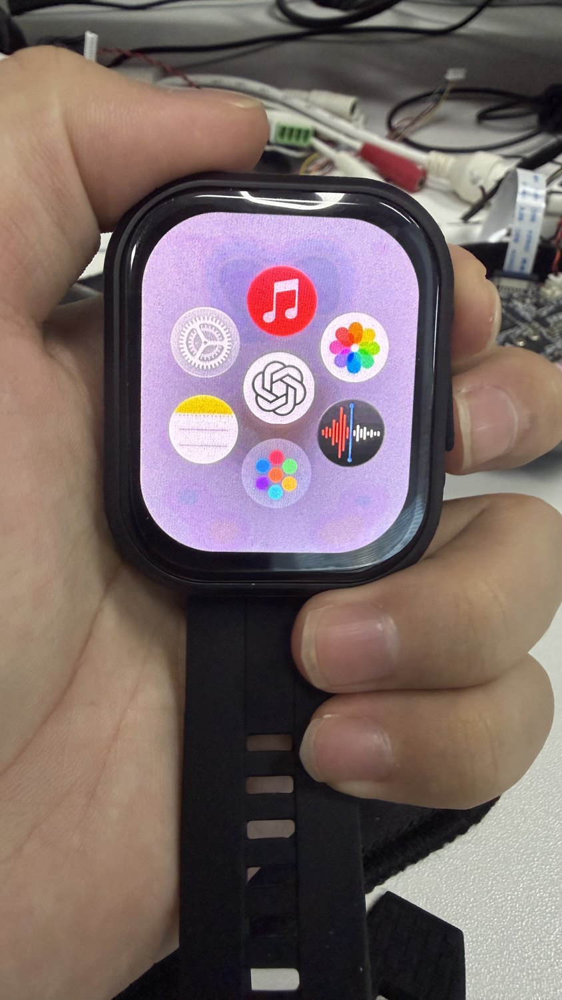
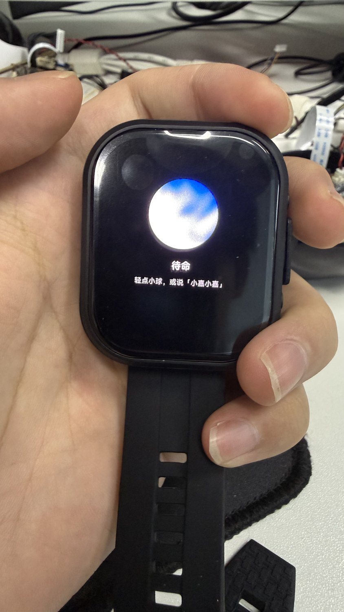
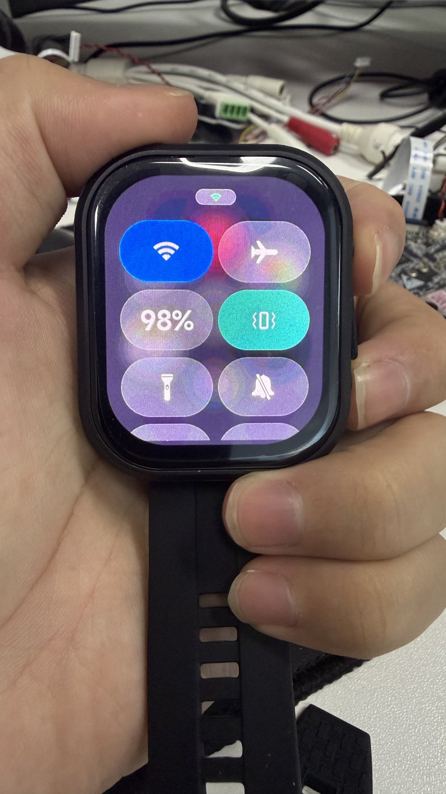
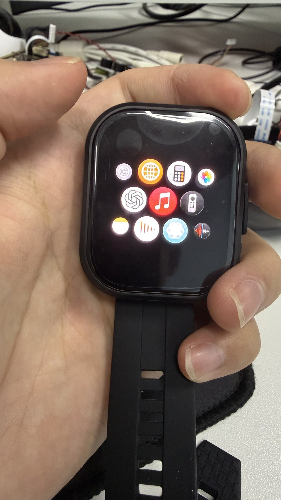

# ESP32-S3 Watch

**基于微雪 ESP32-S3-Touch-AMOLED-2.06 开发板，模仿 Apple watchOS 27 界面与按键交互的手表固件。**

在微雪出厂固件和 ESP-Brookesia 的基础上，加入动态猫咪表盘、毛玻璃控制中心、常用应用与蜂窝应用菜单，以及 ChatGPT 语音模式风格的小嘉语音助手。界面运行在 ESP32-S3 上，使用 ESP-IDF、FreeRTOS 和 LVGL 构建。

> 这是独立的嵌入式界面项目，不运行 Apple watchOS，也不是 Apple 或 OpenAI 的官方产品。语音服务实际接入小智平台，球形界面与图标属于界面设计。

## 实机展示

以下照片来自本项目实机，原图位于本地 `pic/`，仓库展示图经过尺寸压缩和元数据清理。

<table>
  <tr>
    <td align="center"><br><b>动态猫咪表盘</b></td>
    <td align="center"><br><b>常用应用菜单</b></td>
    <td align="center"><br><b>小嘉语音助手</b></td>
  </tr>
  <tr>
    <td align="center"><br><b>毛玻璃控制中心</b></td>
    <td align="center"><br><b>蜂窝应用列表</b></td>
    <td align="center">410 × 502 AMOLED<br>实体双按键<br>触摸 · 抬腕 · 语音</td>
  </tr>
</table>

## 硬件与传感器

目标开发板：[Waveshare ESP32-S3-Touch-AMOLED-2.06](https://www.waveshare.com/wiki/ESP32-S3-Touch-AMOLED-2.06)。硬件信息可参考[微雪官方仓库](https://github.com/waveshareteam/ESP32-S3-Touch-AMOLED-2.06)。

| 部件 | 型号 / 规格 | 本项目中的用途 |
| --- | --- | --- |
| 主控 | ESP32-S3，双核 Xtensa LX7，最高 240 MHz | 图形界面、应用调度、联网与语音处理 |
| 内存与存储 | 512 KB SRAM、8 MB Octal PSRAM；开发板配备 32 MB Flash | PSRAM 存放图像、字体、语音缓冲和部分任务栈；当前工程按 16 MB Flash 分区构建 |
| 屏幕 | 2.06 英寸 AMOLED，410 × 502，QSPI | 表盘、应用与毛玻璃界面；当前 BSP 使用 `sh8601` 兼容驱动 |
| 电容触摸 | FT3168 / FT3x68 兼容驱动，I²C | 点按、列表滚动和应用操作 |
| 六轴 IMU | QMI8658，三轴加速度计 + 三轴陀螺仪 | 抬腕亮屏、放腕息屏、重力球应用；待机时关闭陀螺仪并降低加速度采样率 |
| 实时时钟 | PCF85063A，I²C | RTC 时间维护与时钟应用 |
| 电源管理 | AXP2101 | 电池电量、充电状态与电源状态读取 |
| 音频输入 | ES7210 ADC + 板载双麦克风 | 语音唤醒、语音识别输入、录音与频谱分析 |
| 音频输出 | ES8311 Codec + 扬声器 | AI 语音回答、音乐与提示音播放 |
| 无线 | 2.4 GHz Wi-Fi；芯片支持 BLE | 当前主要使用 Wi-Fi 进行对话、天气和网络校时 |
| 其他 | BOOT / PWR 双按键、TF 卡槽、振动反馈 | 系统导航、唤醒助手、SD 媒体与按键反馈 |

**没有心率、血氧等健康传感器。** 表盘底部的部分数值为装饰显示，不代表真实心率或计步测量；蓝牙也不代表已实现手机通知同步。

## 已实现的功能

### 动态表盘

- 时间、日期、星期、电量进度条和天气展示。
- 11 个随机猫咪 GIF，配合随机中文短句与定制字体；动画显示在文字上方。
- 保留 GIF 原始帧延时，支持息屏时预读下一张动画、准备首帧，亮屏时同步呈现背景和角色。
- 上海 UTC+8 时区，支持 Wi-Fi / SNTP 校时与 RTC 维护；天气默认地区为宜昌。

### watchOS 风格菜单与控制中心

- 常用页采用中心小嘉入口 + 外围六个入口的布局。
- 外围包含音乐、设置、相册、画笔、录音，以及彩色圆点组成的“全部应用”按钮。
- 全部应用页使用黑色背景、蜂窝布局和随离中心距离变化的图标大小。
- PWR 打开毛玻璃控制中心；支持 Wi-Fi、飞行模式、电量、静音、音量、亮度、屏幕手电筒、抬腕开关、振动反馈、保持亮屏、触摸锁、倒计时和快捷息屏。
- 当前菜单切换和控制中心直接呈现最终界面，优先保证操作响应；没有启用高负载的展开 / 聚合动画。

### 小嘉语音助手

- 黑色背景、蓝白色动态球体、中文状态提示。
- 长按 BOOT 进入助手并开始聆听，支持回答后继续聆听的连续对话。
- 在助手应用内支持唤醒词 **“小珈小珈”**，界面昵称显示为“小嘉”；也可轻点小球开始交互。
- 不启用桌面或息屏时的全局语音监听，降低后台负载。
- 使用 ESP-SR / WakeNet、本地音频前处理、WebSocket 和 Opus 语音链路。模型与音色在[小智控制台](https://xiaozhi.me/)配置。

### 内置应用与待机策略

- 音乐、相册、视频播放、录音、画笔、计算器、时钟、重力球、频谱分析和系统设置。
- 媒体应用从 TF / microSD 卡读取文件，示例歌曲、照片和视频需自行准备。
- 抬腕亮屏 / 放腕息屏；息屏时暂停隐藏界面与 GIF 刷新，释放活动电源锁，允许自动 Light-sleep。
- 连续息屏 **60 秒**后暂停 Wi-Fi，连续亮屏 **3 秒**后恢复连接；手动关闭 Wi-Fi 后不会被自动开启。
- `debug.cmake` 提供统一调试开关，默认关闭运行打印、休眠统计及性能采样。续航与休眠效率仍在优化，项目不承诺固定待机时长。

## 按键操作

| 操作 | 功能 |
| --- | --- |
| BOOT 短按 | 打开应用菜单；应用内按下返回菜单 |
| BOOT 长按，约 0.9 秒 | 打开小嘉并聆听 |
| PWR 短按 | 打开 / 收起控制中心 |
| 点击常用页底部彩色圆点 | 进入全部应用页 |
| 抬腕 / 放腕 | 自动亮屏 / 息屏，可在控制中心切换 |

## 技术实现

| 技术 | 用途 |
| --- | --- |
| ESP-IDF v6.1.0 + C / C++ | 当前本地构建工具链与业务实现 |
| FreeRTOS | 显示、状态监测、按键、IMU、网络和音频任务协作 |
| LVGL 9.5.0 + ESP-Brookesia 0.6 系列 | 控件绘制、触摸事件、应用生命周期和导航 |
| 双 DMA 绘图缓冲 + QSPI / TE 同步 | 重叠绘制与传输，协调屏幕刷新；关闭无用的软件旋转缓冲 |
| RGB565 快照与 PSRAM 背景缓存 | 控制中心和菜单的模糊背景 |
| GIF 透明合成与累计时间调度 | 动画透明区域处理、原始帧延时与过期帧追赶 |
| SPIFFS / NVS / FATFS | 内置资源、设置与天气缓存、SD 卡媒体 |
| I²C / I²S / GPIO | 传感器与 PMU、音频采集播放、按键和振动反馈 |
| SNTP / HTTP / WebSocket / Opus | 校时、天气查询、云端对话与语音传输 |
| ESP-IDF PM / DFS / Light-sleep | 亮屏和音频时保持性能，息屏时允许降频与浅睡眠 |

## 编译与烧录

当前工程已在 **ESP-IDF v6.1.0** 下完成编译。推荐使用该版本，LVGL 等组件版本由 `dependencies.lock` 和组件清单记录。使用 VS Code 的 ESP-IDF 终端，或已加载 ESP-IDF 环境的终端：

```powershell
git clone https://github.com/IoTEgr/ESP32-S3_watch-DY.git
cd ESP32-S3_watch-DY
idf.py --version
idf.py set-target esp32s3
idf.py build
idf.py -p COM7 flash
```

串口号按实际设备修改。首次构建会下载 `managed_components/`；构建产物、下载依赖、本地密钥和机器相关配置不随仓库上传。板卡、分区和 PSRAM 等默认设置保存在 `sdkconfig.defaults`。

首次烧录请使用完整 `flash`，以写入引导程序、分区表、应用、ESP-SR 模型和包含动画 / 字体的 SPIFFS；只烧录应用 `.bin` 不足以完成部署。

### 联网与语音

1. 在手表设置中打开 Wi-Fi，连接自己的网络。
2. 打开小嘉应用，按屏幕提示在小智控制台激活 / 绑定设备。
3. 在控制台配置智能体、模型与音色，再开始对话。

### 配置天气接口

天气模块使用易客天气 v9 接口。仓库不包含个人接口凭据；未配置时不请求接口，已有缓存会保留。

复制 `components/weather_service/weather_config.example.h` 为同目录下的 `weather_config.local.h`，填入自己的 `WATCH_WEATHER_APPID`、`WATCH_WEATHER_APPSECRET`，然后重新编译。`*.local.h` 已被 Git 忽略。也可修改默认城市或通过 `weather_service_set_city()` 设置城市。

### 调试总开关

在 `debug.cmake` 中切换：

```cmake
set(WATCH_DEBUG OFF) # 默认：关闭打印与统计；改为 ON 后恢复
```

修改后重新编译、烧录。芯片 ROM 固有启动提示不受应用开关控制，详见 [DEBUG.md](DEBUG.md)。

## 工程结构

```text
main/                    启动、应用安装、显示缓冲和资源镜像构建
components/watch_shell/  表盘、菜单、控制中心与图形资源
components/watch_power/  电源策略及可选休眠诊断
components/watch_debug/  调试打印总开关与控制台过滤
components/system_status/电池、Wi-Fi、延时联网和时间同步
components/wrist_gesture/抬腕姿态检测
components/board_keys/   按键、长按和振动反馈
components/XiaozhiApp/   语音助手、激活流程与球形界面
components/weather_service/天气查询与缓存
patches/                 固定在工程中的 GIF 和音频兼容修复
tools/watchface/         资源生成、电脑预览与验证脚本
spiffs/                  随固件烧录的动画资源
pic/readme/              实机展示照片
```

日常固件构建直接使用已生成的图片、字体和 GIF，不需要运行电脑预览脚本。资源再生成与 Windows 原生预览另见 [tools/watchface/README.md](tools/watchface/README.md)，其中部分工具路径需要按本机环境修改。

## 来源与说明

感谢 [Waveshare](https://github.com/waveshareteam/ESP32-S3-Touch-AMOLED-2.06)、[ESP-IDF](https://github.com/espressif/esp-idf)、[LVGL](https://github.com/lvgl/lvgl)、[ESP-Brookesia](https://github.com/espressif/esp-brookesia)、[xiaozhi-esp32](https://github.com/78/xiaozhi-esp32) 及项目使用的其他组件。

各第三方代码保留其原始版权声明和许可。Apple / ChatGPT 风格图标、猫咪动图、字体等视觉素材的权利归各自权利人，不因本仓库公开而统一重新授权。图标来源记录可见 `tools/watchface/icon_sources/sources.json`；已引入代码的许可文本保留在对应组件或补丁目录中。
